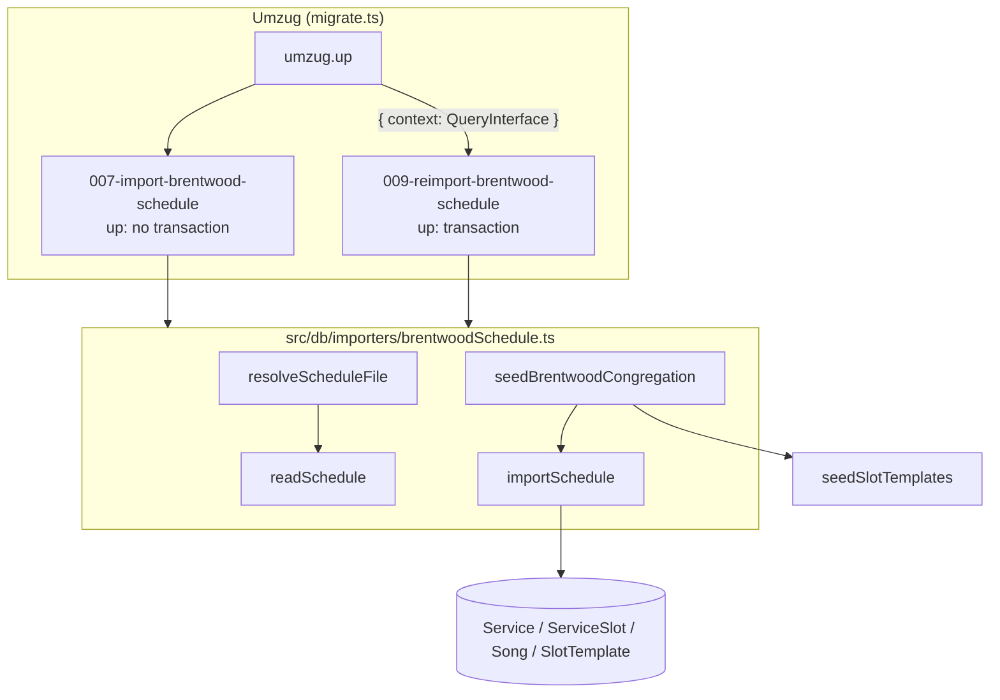
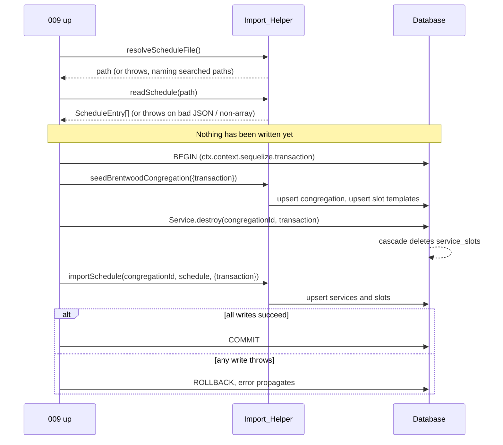

# Design Document

## Overview

Migration `009-reimport-brentwood-schedule.ts` replaces the Brentwood Park schedule with the contents of `.data/brentwood-schedule-latest.json`. It deletes every Brentwood Park `Service` (the foreign key cascade removes their `ServiceSlot` rows) and re-imports the file, all inside one database transaction.

The import logic currently inlined in migration 007 moves into a shared helper module. Migrations 007 and 009 both call it. 007 keeps its behavior (upserts, no transaction). 009 adds the delete step and wraps everything in a transaction.

Design decisions (both approved with the requirements):

| Decision | Choice | Reason |
|---|---|---|
| Atomicity | Delete and re-import run in one transaction. The file is located, read and parsed before the transaction opens. | A failed import must not leave Brentwood Park with no services (Req 3.6 to 3.8). |
| `down` | Deletes only Brentwood Park services. The congregation and slot templates stay. | They may predate 009 (created by 007), so removing them would undo more than 009 did (Req 8). |

Additional decisions made in this design:

- The transaction comes from `ctx.context.sequelize` (the `QueryInterface` Umzug passes in), not from the production `sequelize` singleton. This keeps the migration working against the test SQLite instance.
- The helper lives in `src/db/importers/`, not in `src/db/migrations/`, because Umzug loads every `migrations/*.ts` file as a migration.
- `seedSlotTemplates` gains an optional `transaction` parameter. Without it, slot templates created inside the transaction would be invisible to the transaction's own reads on Postgres.
- A schedule file that parses to something other than a JSON array fails the same pre-delete check as invalid JSON. Requirement 3.7 only names invalid JSON. This is a small addition, and the alternative is a `TypeError` after the delete, which the transaction would roll back anyway.

## Architecture



### Flow of 009 `up`



If `up` throws, Umzug does not record the migration in `SequelizeMeta`, so the next `npm run migrate` retries it.

## Components and Interfaces

### Import_Helper: `music-planner-api/src/db/importers/brentwoodSchedule.ts`

Location rationale: `migrate.ts` globs `migrations/*.ts`, so a helper placed in `migrations/` would run as a migration. The new `src/db/importers/` folder sits beside `migrations/`, so the relative path to the data file is unchanged (`__dirname` is the same depth under both `src/` and `dist/`).

```typescript
import { Transaction } from 'sequelize';

export const CONGREGATION_NAME = 'Brentwood Park';
export const CONGREGATION_TIMEZONE = 'Africa/Johannesburg';

export interface ScheduleSong { type: string; number: string; [key: string]: unknown }
export interface ScheduleEntry { date: string; serviceType: string; songs: ScheduleSong[] }

export interface ImportOptions { transaction?: Transaction }

export interface ImportSummary {
  services: number;
  slots: number;
  slotsWithoutSong: number;
}

/** First 10 characters of an ISO date-time (the calendar date). */
export function parseDate(isoString: string): string;

/** True for '', 'N/A' (any case) and 'N/A' with stray punctuation. */
export function isEmptySong(rawNumber: string): boolean;

/** Finds the schedule file. Throws an Error listing every path searched. */
export function resolveScheduleFile(): string;

/** Reads and parses the file. Throws if it is not valid JSON or not an array. */
export function readSchedule(filePath: string): ScheduleEntry[];

/** Upserts the Brentwood Park congregation and its slot templates. Returns the congregation id. */
export async function seedBrentwoodCongregation(options?: ImportOptions): Promise<string>;

/** Upserts services and slots for every entry. Logs warnings and the summary. */
export async function importSchedule(
  congregationId: string,
  schedule: ScheduleEntry[],
  options?: ImportOptions,
): Promise<ImportSummary>;
```

Behavior carried over unchanged from 007 (Req 4):

- `parseDate` returns `isoString.substring(0, 10)`.
- `isEmptySong` applies the existing rule: trim and upper-case, then `''`, `'N/A'`, or `'N/A'` after stripping characters outside `A-Z0-9/`.
- `importSchedule` builds `slotKey -> SlotTemplate.id` for the congregation and `UPPER(number) -> Song.id` for all songs. For each entry it upserts the service and, for each song entry, upserts a slot. An unknown `type` is skipped with a warning naming the slot key, date and service type. An empty number stores `songId = null`. An unknown number stores `songId = null` and is collected into a set, which is logged once as a single warning. The summary counts are logged at the end.
- Every model call in the helper receives `{ transaction: options.transaction }`. When the transaction is `undefined` (007), Sequelize ignores it.

`readSchedule` takes the path as a parameter (Req 1.4). `resolveScheduleFile` is separate so a caller can validate the file before it opens a transaction.

### Changes to `seedSlotTemplates`

```typescript
export async function seedSlotTemplates(
  congregationId: string,
  options: { transaction?: Transaction } = {},
): Promise<void>
```

`SlotTemplate.upsert` receives `{ transaction: options.transaction }`. The default argument keeps the existing callers (`seedInit.ts`, the CLI entry point) unchanged.

### Migration 007 (refactored)

```typescript
export async function up(_ctx: { context: QueryInterface }): Promise<void> {
  initAssociations();
  const schedule = readSchedule(resolveScheduleFile());
  const congregationId = await seedBrentwoodCongregation();
  await importSchedule(congregationId, schedule);
}
```

`down` is unchanged, except that it imports `CONGREGATION_NAME` from the helper. One observable difference: the file is now read before the congregation is seeded, so a missing file fails before the congregation upsert instead of after. On success the database content is identical (Req 1.5).

### Migration 009 (new)

Header comment (Req 7.3, 8.4): states that `up` discards in-app edits to Brentwood Park services and that `down` cannot restore the earlier schedule.

```typescript
export async function up(ctx: { context: QueryInterface }): Promise<void> {
  initAssociations();

  // Pre-flight: no database writes yet (Req 3.6, 3.7).
  const schedule = readSchedule(resolveScheduleFile());

  await ctx.context.sequelize.transaction(async (transaction) => {
    const congregationId = await seedBrentwoodCongregation({ transaction });
    const removed = await Service.destroy({ where: { congregationId }, transaction });
    console.log(`Removed ${removed} existing services for "${CONGREGATION_NAME}".`);
    await importSchedule(congregationId, schedule, { transaction });
  });
}

export async function down(ctx: { context: QueryInterface }): Promise<void> {
  initAssociations();
  const congregation = await Congregation.findOne({ where: { name: CONGREGATION_NAME } });
  if (!congregation) { console.log('... nothing to roll back.'); return; }
  const removed = await Service.destroy({ where: { congregationId: congregation.id } });
  console.log(`Removed ${removed} services for "${CONGREGATION_NAME}".`);
}
```

`down` is a single delete statement, so it needs no explicit transaction.

### How the transaction works

**Umzug context.** `migrate.ts` passes `sequelize.getQueryInterface()` as `context`, so a migration has no transaction handle. A `QueryInterface` exposes its owning instance as `.sequelize`, and `sequelize.transaction(callback)` is a managed transaction: it commits when the callback resolves and rolls back when it throws. In tests `ctx.context` comes from `testSequelize`, so the same code path runs against SQLite.

**Passing `transaction`.** Sequelize does not use the transaction implicitly (no CLS is configured). Every call inside the callback must pass `{ transaction }`:

| Call | Where | Why it must carry the transaction |
|---|---|---|
| `Congregation.upsert` | `seedBrentwoodCongregation` | Congregation created in the transaction must roll back with it. |
| `SlotTemplate.upsert` | `seedSlotTemplates` | Same. |
| `SlotTemplate.findAll` | `importSchedule` | On Postgres, uncommitted templates are invisible to other connections. |
| `Song.findAll` | `importSchedule` | Consistency; reads run on the transaction's connection. |
| `Service.destroy` | 009 | The delete must roll back on failure. |
| `Service.upsert` | `importSchedule` | The returned `service.id` is used for slots, and rows must roll back. |
| `ServiceSlot.upsert` | `importSchedule` | Same. |

The cascade runs in the database (`ON DELETE CASCADE` from migration 005), so deleting services inside the transaction also deletes their slots inside it. No extra `ServiceSlot.destroy` is needed.

No DDL runs in 009, so the transaction is safe on Postgres.

**SQLite test database.** The test instance uses `storage: ':memory:'`. Sequelize's SQLite connection manager keeps one shared connection for in-memory databases, so `BEGIN`, `COMMIT` and `ROLLBACK` apply to that connection and the managed transaction works. Two consequences for tests:

1. Because the connection is shared, a call that forgets `{ transaction }` still runs inside the open transaction, so the rollback test cannot detect the omission. The test strategy therefore adds explicit assertions that each call receives a `transaction` option.
2. `enableSqliteCompat()` in `songNameMigration.test.ts` mocks `testSequelize.query` and forwards `options`. Transaction control statements pass through it unchanged, so the 001 to 009 sequence test can use it.

SQLite enforces foreign keys only when `PRAGMA foreign_keys` is on. Sequelize turns it on when it opens a SQLite connection, and the existing 007 `down` already relies on the cascade, so the cascade behaves the same in tests.

## Data Models

No schema changes. The migration works on existing tables:

| Table | Use in 009 |
|---|---|
| `congregations` | Upsert `Brentwood Park` (unique on `name`). |
| `slot_templates` | Upsert 14 templates for Brentwood Park (unique on `congregation_id, service_type, slot_key`). |
| `services` | Delete all rows for Brentwood Park. Insert one row per distinct `(service_date, service_type)` (unique on `congregation_id, service_date, service_type`). |
| `service_slots` | Rows removed by cascade, then inserted (unique on `service_id, slot_template_id`). `song_id` is nullable. |
| `songs` | Read only. |

**Duplicate entries.** If the file contains two entries with the same `date` and `serviceType`, the service upsert maps both to one row and the later entry's slots overwrite earlier slots with the same `slotKey`. This yields one service per distinct pair (Req 3.4) and matches 007's behavior.

**Schedule file.** An array of `ScheduleEntry`. Only the first 10 characters of `date` are stored.

## Correctness Properties

Each correctness property below is a statement that should hold across all valid executions of the migration and its helper. Properties link the written requirements to automated checks.

Testing with generated inputs applies to the import logic: `parseDate`, `isEmptySong` and song resolution are pure, and the import and delete steps run against an in-memory database at low cost. Criteria about Umzug scheduling (2.2, 2.3, 2.5), file structure (1.1 to 1.3, 2.1) and header comments (7.3, 8.4) are not properties and are covered by examples or review.

Reflection: the criteria on deleting old services (3.1, 3.2, 7.1), importing every entry (3.3 to 3.5), the fresh and empty-congregation cases (6.1, 6.3) and 007's output (1.5) all follow from one statement: the final Brentwood Park state depends only on the schedule, not on the prior state. They are merged into Property 1. Criteria 5.1 to 5.4 and 8.3 share a snapshot comparison and are merged into Property 4. Criteria 4.1 and 4.2 form Property 2.

### Property 1: Re-import result depends only on the schedule

For any prior set of Brentwood Park services and slots (including none) and any schedule, after `up` the Brentwood Park services are exactly one per distinct `(date[0..10], serviceType)` pair of the schedule, and for each service the slots are exactly those entries whose `type` matches a Brentwood Park slot template (last entry wins on a repeated type), each slot holding the resolved song id or null. No `service_slots` row references a missing service.

**Validates: Requirements 3.1, 3.2, 3.3, 3.4, 3.5, 6.1, 6.3, 7.1, 1.5**

### Property 2: Song number resolution

For any song number string and any repertoire, an empty value (`''`, `N/A` in any case, or `N/A` with stray punctuation) resolves to a null `songId`; a number that equals a repertoire number after trimming and upper-casing resolves to that song's id regardless of letter case and surrounding whitespace; any other number resolves to a null `songId`.

**Validates: Requirements 4.1, 4.2, 4.3**

### Property 3: Service date is the first ten characters

For any ISO 8601 date-time string, `parseDate` returns its first 10 characters, and the `serviceDate` stored for an entry with that `date` equals that value.

**Validates: Requirements 4.5**

### Property 4: Other congregations, templates and songs are untouched

For any second congregation with its own slot templates, services and slots, any song table, and any schedule, the rows of every table that do not belong to Brentwood Park are identical before and after `up`, and identical before and after `down`.

**Validates: Requirements 5.1, 5.2, 5.3, 5.4, 8.3**

### Property 5: A failed import leaves Brentwood Park unchanged

For any prior Brentwood Park state, any schedule with at least one song entry, and any write in the import that fails (the k-th service or slot upsert rejects), `up` rejects and the Brentwood Park services and slots equal their prior state.

**Validates: Requirements 3.8**

### Property 6: `down` removes all Brentwood Park services

For any prior Brentwood Park state, after `down` no service of Brentwood Park and no slot of such a service remains, and the congregation and its slot templates are still present.

**Validates: Requirements 8.1**

## Error Handling

| Condition | Behavior | Database state |
|---|---|---|
| Schedule file not found | `resolveScheduleFile` throws, listing both candidate paths. | Unchanged. No transaction opened. |
| File is not valid JSON | `readSchedule` throws with the file path and the parse error. | Unchanged. |
| File parses but is not an array | `readSchedule` throws. | Unchanged. |
| Write fails during the transaction (constraint, connection loss, malformed entry such as `songs: null`) | Managed transaction rolls back and rethrows. Umzug does not record 009. | Unchanged from before 009. |
| Unknown slot key | Entry skipped, warning names key, date and service type. | Import continues. |
| Unknown song number | `songId` null. One warning lists every distinct unknown number. | Import continues. |
| `down` with no Brentwood Park congregation | Logs that there is nothing to roll back and returns. | Unchanged. |

Rollback also removes a congregation or slot templates created by 009 in the same run, so a failed run on a fresh database leaves no partial Brentwood Park data.

## Testing Strategy

Framework: Jest with ts-jest, in-memory SQLite, as for the existing tests. Property tests use `fast-check` (already a devDependency) and run at least 100 iterations each. Each property test carries a comment tag naming the feature, the property number and the property text (for example, `Feature: brentwood-schedule-reimport, Property 1: Re-import result depends only on the schedule`). Each property is one property test.

### Test files

- `src/tests/brentwoodImporter.test.ts`: unit and property tests for the helper (`parseDate`, `isEmptySong`, `readSchedule`, `resolveScheduleFile`, `importSchedule` warnings and counts).
- `src/tests/brentwoodReimportMigration.test.ts`: tests for migrations 007 and 009 and the 001 to 009 sequence.

Both files declare their own `jest.mock('fs', ...)` block and `mockFiles` variable, copied from `songNameMigration.test.ts`, because `jest.mock` is hoisted and must live in the test file. The schedule JSON is supplied through `mockFiles['brentwood-schedule-latest.json']`.

### Setup

- Most tests call `setupTestDb()` (`sync({ force: true })`) in `beforeEach`, create songs with `Song.create`, and invoke `m009.up({ context: testSequelize.getQueryInterface() })` directly.
- The sequence test reuses `enableSqliteCompat()`, `mockCsv()` and the migrations 001 to 009, as in `songNameMigration.test.ts`.
- `console.log` and `console.warn` are spied on and silenced, then restored in `afterEach`.
- Snapshot helper: reads `congregations`, `slot_templates`, `services`, `service_slots` and `songs` with raw `SELECT` and splits rows into Brentwood Park and other, ignoring `updated_at`.

### Property tests

Generators: a repertoire of unique song numbers; schedule entries with ISO dates, `serviceType` from a small set (to produce duplicate pairs), `type` from the 14 slot keys plus occasional unknown keys, and `number` drawn from known numbers (with case and whitespace perturbations), empty variants and unknown numbers. Prior state is a random set of Brentwood Park and other-congregation services and slots, possibly empty.

| Property | Approach |
|---|---|
| 1 | Seed a random prior state, run `m009.up`, and compare Brentwood Park rows to an expected state computed by a small independent model of the schedule. |
| 2 | Run `isEmptySong` and the resolution step against generated numbers and a generated repertoire. |
| 3 | Run `parseDate` on generated ISO strings. |
| 4 | Snapshot non-Brentwood rows before and after `up`, and before and after `down`. |
| 5 | Spy on `ServiceSlot.upsert` (or `Service.upsert`) to reject on the k-th call, snapshot before, expect `up` to reject, snapshot after. |
| 6 | Seed a random prior state, run `down`, assert Brentwood services and slots are gone and the congregation and templates remain. |

### Example tests

- **Transaction wiring** (compensates for the shared SQLite connection): spy on `Congregation.upsert`, `SlotTemplate.upsert`, `SlotTemplate.findAll`, `Song.findAll`, `Service.destroy`, `Service.upsert` and `ServiceSlot.upsert`, run `m009.up`, and assert every call received an options object with a `transaction`.
- **Pre-flight failures** (Req 3.6, 3.7): with prior services present, a missing file rejects with both searched paths in the message, and malformed JSON rejects. In both cases the prior services remain and `sequelize.transaction` was never called.
- **Fresh database** (Req 6.1): no Brentwood Park congregation exists; `up` creates it, 14 slot templates and the scheduled services.
- **Sequence** (Req 2.4, 6.2): migrations 001 to 009 on an empty database, then the Brentwood Park services and slots match the mocked schedule.
- **Second congregation** (Req 9.3): a concrete case with two congregations.
- **Differing prior services** (Req 9.4): prior services that differ from the file are gone after `up`.
- **Warnings and counts** (Req 4.3, 4.4, 4.6, 7.2): known fixtures produce one unknown-number warning with de-duplicated numbers, an unknown-slot-key warning naming key, date and type, the logged counts, and the logged deleted-service count.
- **`down`** (Req 8.1, 8.2): an existing congregation, and an absent congregation (logs "nothing to roll back").
- **Migration 007** (Req 1.5, 1.6): `m007.up` on an empty database produces the expected rows, and `m007.down` removes the services.
- **Regression**: `songNameMigration.test.ts` and the rest of the suite still pass (Req 9.8).

### Not tested

Umzug's skip-if-recorded behavior (Req 2.2, 2.3, 2.5) belongs to the Umzug library. Postgres-specific behavior is not exercised, since the test database is SQLite. The `transaction` wiring test is the guard against the Postgres-only failure of forgetting to pass the transaction.
