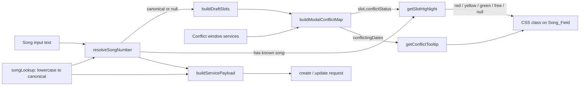

# Design Document

## Overview

This change touches the shared Service Dialog (`AddServiceDialogComponent`) in three ways:

1. The red/yellow/green conflict badge dot is removed. The song field itself gets a tinted background in the same severity colors the service card uses.
2. A song with a valid repertoire number and no conflict gets a light blue tint. Empty slots, unknown songs, and any state where conflicts cannot be computed get no tint.
3. Song entry becomes case-insensitive. Typed text is resolved to the canonical repertoire number (`a10` becomes `A10`) before the unknown-song check, the conflict computation, and the save payload.

The existing conflict engine (`buildModalConflictMap`) and the API layer are unchanged. All new decision logic goes into small pure functions so that it can be property-tested. The component only wires those functions to the template.

Research findings that shaped the design:

- `repertoire.json` has 1444 songs and no two numbers differ only by letter case (checked), so a lowercase-keyed lookup is unambiguous.
- `buildModalConflictMap` returns an entry for every draft slot it receives, with `severity: null` when there is no conflict. "Known song with no conflict" is therefore distinguishable from "no status computed" (`conflictStatus === null`).
- The service card slot item (`slot-item.component.css`) tints with `rgba(244,67,54,.15)` (red), `rgba(255,193,7,.15)` (yellow) and `rgba(76,175,80,.15)` (green). The dialog reuses these values.
- Angular Material 17 `mat-form-field` internals (`.mat-mdc-text-field-wrapper`) sit behind view encapsulation, so the tint needs `::ng-deep` scoped under the component's own `.slot-field` class.
- Tooltip text is rendered in a CDK overlay outside the component's view, so multi-line display (`white-space: pre-line`) needs a rule in the global `src/styles.css` bound through `matTooltipClass`.

## Architecture



Design decisions:

| Decision | Rationale |
|---|---|
| Resolution lives in `service-form.util.ts` as pure functions taking a lookup map | Testable without TestBed; the dialog and the payload builder share one definition of "matches the repertoire". |
| `buildServicePayload` takes an optional lookup and canonicalizes there | The payload is the last gate before the API. Canonicalizing in the builder guarantees canonical output even if a caller forgets to resolve. |
| `getSlotHighlight` is a pure function in `modal-conflict.util.ts` | The color rules (including light blue) become a total mapping that a property test can cover. |
| Highlight is computed from `slot.conflictStatus` and the resolver, with a `conflictWindowLoaded` flag | Prevents showing light blue ("no conflict") before the conflict window has loaded or after the fetch failed. |
| Display text is canonicalized on blur, not on every keystroke | Rewriting while typing would fight the cursor and the autocomplete filter. |
| `buildModalConflictMap` is not modified | Its input contract ("already validated as present in repertoire") is met by `buildDraftSlots` passing canonical numbers. |

## Components and Interfaces

### `service-form.util.ts`

```ts
/** Lowercase song number -> canonical number. */
export function buildSongLookup(entries: { number: string }[]): Map<string, string>;

/**
 * Trims, ignores letter case, returns the canonical number.
 * Returns null for blank, 'N/A' (any case) and for text not in the repertoire.
 */
export function resolveSongNumber(
  value: string | null | undefined,
  lookup: Map<string, string>
): string | null;

/** Existing signature plus an optional lookup. */
export function buildServicePayload(
  serviceDate: moment.Moment,
  serviceType: string,
  slots: { slotKey: string; songNumber: string }[],
  songLookup?: Map<string, string>
): CreateServicePayload;
```

`buildServicePayload` behavior for each slot: `normalizeSongInput` returns null gives `songNumber: null`. Otherwise the value is `songLookup?.get(lower) ?? trimmed`. Unknown text is passed through trimmed so the server remains the final validator, as it is today. The result still has exactly 14 entries in `SLOT_TEMPLATES` order.

`normalizeSongInput` is unchanged (it already treats `N/A` case-insensitively).

### `modal-conflict.util.ts`

```ts
export type SlotHighlight = 'red' | 'yellow' | 'green' | 'free';

/** Draft slots for buildModalConflictMap: known songs only, canonical numbers. */
export function buildDraftSlots(
  slots: { slotKey: string; songNumber: string }[],
  lookup: Map<string, string>
): DraftSlot[];

/**
 * null  -> no highlight (no known song, or no conflict status computed)
 * 'free'-> known song, status computed, severity null (light blue)
 * else  -> the severity
 */
export function getSlotHighlight(
  hasKnownSong: boolean,
  status: SlotConflictStatus | null
): SlotHighlight | null;
```

### `AddServiceDialogComponent`

Changes:

- Replace `repertoireSet` with `songLookup = buildSongLookup(repertoire)`. Keep `repertoireMap` keyed by canonical number.
- `isUnknownSong(slot)`: `normalizeSongInput(slot.songNumber) !== null && resolveSongNumber(slot.songNumber, songLookup) === null`.
- `repertoireValidatorFn()`: same rule, so it is case-insensitive too.
- `rebuildConflictMap()`: uses `buildDraftSlots`. When no date is set or `conflictWindowLoaded` is false, it sets every `conflictStatus` to null and returns.
- `fetchConflictWindow()`: sets `conflictWindowLoaded = false` before the request, `true` on success, and `false` on error (with `windowServices = []`).
- `getHighlight(slot)`: `getSlotHighlight(resolveSongNumber(slot.songNumber, songLookup) !== null, slot.conflictStatus)`.
- `getConflictTooltip(slot)`: returns the joined dates only when the highlight is red, yellow or green, otherwise `''`.
- `onSongBlur(slot)`: when the input resolves to a canonical number, set `slot.songNumber` to it, then rebuild the conflict map.
- `onSave`: passes `this.songLookup` to `buildServicePayload`.
- Remove `hasSong` (only the badge used it).
- `filterOptions` already matches on lowercase prefix and stays unchanged.

### Template (`add-service-dialog.component.html`)

The `.conflict-badge` span is deleted. The `mat-form-field` gets:

```html
<mat-form-field appearance="outline" class="slot-field"
    [ngClass]="getHighlight(slot) ? 'highlight-' + getHighlight(slot) : ''"
    [matTooltip]="getConflictTooltip(slot)"
    [matTooltipDisabled]="!getConflictTooltip(slot)"
    matTooltipClass="conflict-tooltip"
    matTooltipPosition="above">
```

and the input gets `(blur)="onSongBlur(slot)"`. The `ngModel` stays on `slot.songNumber` (template-driven, per workspace rules).

### Styles

`add-service-dialog.component.css` replaces `.conflict-badge` and `.conflict-red/yellow/green` with:

```css
.slot-field.highlight-red    ::ng-deep .mat-mdc-text-field-wrapper { background-color: rgba(244, 67, 54, 0.15); }
.slot-field.highlight-yellow ::ng-deep .mat-mdc-text-field-wrapper { background-color: rgba(255, 193, 7, 0.15); }
.slot-field.highlight-green  ::ng-deep .mat-mdc-text-field-wrapper { background-color: rgba(76, 175, 80, 0.15); }
.slot-field.highlight-free   ::ng-deep .mat-mdc-text-field-wrapper { background-color: rgba(79, 195, 247, 0.25); }
```

`src/styles.css` gains `.conflict-tooltip { white-space: pre-line; }`.

## Data Models

No API or database changes. New in-memory shapes:

| Name | Type | Purpose |
|---|---|---|
| `songLookup` | `Map<string, string>` | lowercase repertoire number to canonical number (1444 entries) |
| `SlotHighlight` | `'red' \| 'yellow' \| 'green' \| 'free'` | highlight kind; `null` means none |
| `conflictWindowLoaded` | `boolean` | true only after the conflict window for the current date loaded successfully |

`SlotState` is unchanged. `'N/A'` stays the empty placeholder: the payload sends `null` for it, as today.


## Correctness Properties

*A property is a characteristic or behavior that should hold true across all valid executions of a system-essentially, a formal statement about what the system should do. Properties serve as the bridge between human-readable specifications and machine-verifiable correctness guarantees.*

Reflection on redundancy: criteria 2.1, 2.2 and 2.3 are cases of the same total mapping as 1.1 to 1.3, so they form one property. Criterion 6.2 follows from 6.1 together with the resolution property, so it needs no separate entry. Criteria 5.6, 7.1, 7.2 and 7.3 all describe the output of `buildServicePayload` and form one property.

### Property 1: Case-insensitive resolution returns the canonical number

*For any* repertoire entry, any letter-case permutation of its number, and any amount of surrounding whitespace, `resolveSongNumber` returns the entry's canonical number.

**Validates: Requirements 5.1**

### Property 2: Non-matching input resolves to no song

*For any* string whose trimmed, lowercased form is not a key of the song lookup, `resolveSongNumber` returns null.

**Validates: Requirements 5.2**

### Property 3: Resolution is idempotent

*For any* string, if `resolveSongNumber` returns a canonical number, then resolving that canonical number returns the same canonical number.

**Validates: Requirements 5.3**

### Property 4: Payload carries canonical numbers, nulls for empty slots, and 14 ordered entries

*For any* assignment of slot inputs, where each input is a case-varied repertoire number, blank text, or `N/A` in any letter case, `buildServicePayload` with the song lookup returns exactly 14 slot entries in `SLOT_TEMPLATES` order. Each entry with a known song has the canonical number, and each entry with a blank or `N/A` input has `songNumber` null.

**Validates: Requirements 5.6, 7.1, 7.2, 7.3**

### Property 5: Highlight mapping is total and follows the severity

*For any* combination of `hasKnownSong` and conflict status (null, or severity red, yellow, green or null with any conflicting dates), `getSlotHighlight` returns null when `hasKnownSong` is false or the status is null. Otherwise it returns the severity when the severity is non-null, and `'free'` when the severity is null.

**Validates: Requirements 1.1, 1.2, 1.3, 2.1, 2.2, 2.3**

### Property 6: Conflict results do not depend on input letter case

*For any* set of window services and any draft slot inputs, the conflict map built from `buildDraftSlots` for case-varied, whitespace-padded inputs equals the conflict map built from the same slots written with canonical numbers.

**Validates: Requirements 6.1, 6.2**

## Error Handling

| Situation | Behavior |
|---|---|
| Conflict window request fails | `windowServices` is emptied, `conflictWindowLoaded` stays false, every `conflictStatus` is null, no field is highlighted. The form stays usable and Save still works. |
| Service date cleared | `windowServices` is emptied, `conflictWindowLoaded` is set to false, no highlights. |
| Date changed while a request is pending | `conflictWindowLoaded` is false until the new response arrives, so no stale light blue shows. |
| Input is not in the repertoire (any case) | No highlight. After a Save attempt the existing `Unknown song number.` error shows and the save is blocked. |
| Input is `N/A` in any case or blank | Treated as empty: no highlight, no error, `null` in the payload. |
| Server rejects the payload (400, 409, other) | Unchanged from the current dialog behavior. |

## Testing Strategy

Property-based testing applies because the new logic is pure (string resolution, payload building, highlight mapping, conflict map construction) and its input space is large. The template, CSS and tooltip are UI rendering, which is covered by example-based component tests, not property tests.

**Property tests** use `fast-check` (already a dependency, used in `service-form.util.spec.ts`). Each property is one test, runs at least 100 iterations (`fc.assert` default is 100; set `numRuns: 100` explicitly), and carries a comment in the form `Feature: dialog-conflict-field-highlight, Property N: <title>`.

| Property | File | Generators |
|---|---|---|
| 1, 2, 3 | `service-form.util.spec.ts` | repertoire entries from `repertoire.json`; per-character case flip; whitespace padding; arbitrary strings filtered against the lookup |
| 4 | `service-form.util.spec.ts` | for each of the 14 slot keys: case-varied number, blank, or an `N/A` case variant |
| 5 | `modal-conflict.util.spec.ts` (new) | boolean, severity in red/yellow/green/null, list of conflicting dates, status null or present |
| 6 | `modal-conflict.util.spec.ts` (new) | a few window services with songs from the repertoire and dates within and beyond 365 days; draft slots with case-varied inputs |

**Unit and component tests** (`add-service-dialog.component.spec.ts`, Karma/Jasmine, using the existing `setup` helper with a mocked `ServicesApiService`):

- Highlight classes `highlight-red|yellow|green|free` appear on the correct `.slot-field` in add mode and edit mode (1.1 to 1.5, 2.1).
- No `.conflict-badge` element exists when conflicts are present (1.6).
- Empty, `N/A` and unknown slots have no highlight class; no date means no highlight; a failed `getServices` means no highlight and Save still calls the API (2.2 to 2.5).
- `getConflictTooltip` lists `date (type)` per line for conflicting slots and returns `''` for free slots (3.1, 3.2).
- Typing, changing the date and clearing the date update highlights (4.1 to 4.3); the edited service is excluded in edit mode (4.4).
- `a10` is not unknown, `ZZZ999` is, and Save with an unknown song is blocked with the error shown (5.4, 5.5).
- Blur rewrites `a10` to `A10`; the update payload contains `A10` (7.1, 7.4).
- `filterOptions('a1')` returns entries starting with `A1`; empty text returns none (8.1, 8.2).

The existing dialog tests (edit prefill, 409/400/500 handling, spinner, clear-to-null, `N/A`, unknown blocking) stay and must keep passing.

Run tests with `npm test` in `music-planner-app` (Karma opens a browser).
