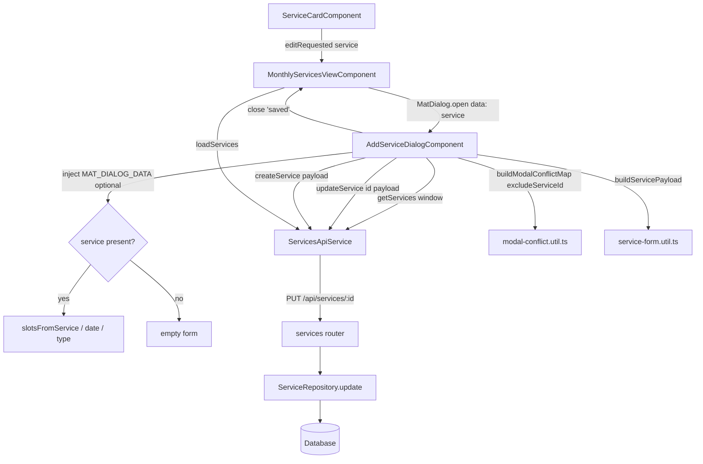

# Design Document: Edit Service Modal

## Overview

The edit flow reuses `AddServiceDialogComponent` in a second mode. An "Edit" button in each service card header asks `MonthlyServicesViewComponent` to open the dialog with the service passed through `MAT_DIALOG_DATA`. When data is present the dialog pre-fills the date, type and 14 slots, shows the title "Edit Service", and saves with `PUT /api/services/:id`. Without data it behaves as before.

Three things change beyond the UI wiring:

1. **Backend**: `PUT /api/services/:id` currently updates only slots by `songId` (used by drag-and-drop swaps). It is extended to accept `serviceDate`, `serviceType`, and slots by `songNumber`. The `songId` path stays unchanged.
2. **Conflict detection**: the dialog drops the edited service's saved version from the conflict window, otherwise every song would conflict with its own saved copy.
3. **Pure helpers**: pre-fill, empty-value normalization and payload building move into a small pure module so they can be property-tested.

Findings from the code that drive the design:

- `ServiceRepository.upsertSlots` writes `entry.songId ?? null` and ignores `songNumber`. `create` already resolves `songNumber` through `Song.findOne`.
- `services` has a unique index on (`congregation_id`, `service_date`, `service_type`), so a changed date or type can collide. The existing error handler already maps `UniqueConstraintError` to 409 (covered by the POST integration test).
- `findTemplate` falls back to any template with the same `slotKey`, so changing the type still resolves slot templates.
- The slot `Song.number` returned by the API is the same string the repertoire autocomplete uses, so it can pre-fill the inputs directly.
- The dialog sets `DateAdapter` and `MAT_DATE_FORMATS` in the component `providers`. This is kept.

---

## Architecture



### Modified files

```
music-planner-app/src/app/monthly-services-view/
  monthly-services-view.component.ts        # openEditServiceDialog(service), pass to cards
  monthly-services-view.component.html      # bind (editRequested) on both cards
  components/service-card/
    service-card.component.ts               # editRequested output, MatButton import
    service-card.component.html             # Edit button in header, disabled while swapping
  components/add-service-dialog/
    add-service-dialog.component.ts         # optional MAT_DIALOG_DATA, edit mode
    add-service-dialog.component.html       # dynamic title, uses helpers
  services/services-api.service.ts          # updateService()
  services/modal-conflict.util.ts           # optional excludeServiceId parameter
  models/service.model.ts                   # UpdateServicePayload

music-planner-api/src/
  api/routes/services.ts                    # extended PUT handler
  repositories/ServiceRepository.ts         # update(), shared slot resolution
```

### New files

```
music-planner-app/src/app/monthly-services-view/services/
  service-form.util.ts                      # pure helpers: slotsFromService, normalizeSongInput, buildServicePayload
```

---

## Components and Interfaces

### ServiceCardComponent

Adds `@Output() editRequested = new EventEmitter<ServiceViewModel>()` and a header button:

```html
<mat-card-header>
  <div class="header-text">
    <mat-card-title>{{ service.serviceDate }}</mat-card-title>
    <mat-card-subtitle>{{ service.serviceType }}</mat-card-subtitle>
  </div>
  <button mat-stroked-button class="edit-button"
          [disabled]="swapping"
          (click)="editRequested.emit(service)">Edit</button>
</mat-card-header>
```

`MatButtonModule` is added to the component's `imports`. The CSS places the button at the right edge of the header.

### MonthlyServicesViewComponent

Both `<app-service-card>` usages gain `(editRequested)="openEditServiceDialog($event)"`.

```typescript
openEditServiceDialog(service: Service): void {
  const dialogRef = this.dialog.open(AddServiceDialogComponent, {
    width: '800px',
    disableClose: true,
    data: { service }
  });
  dialogRef.afterClosed().subscribe(result => {
    if (result === 'saved') this.loadServices(this.selectedMonth);
  });
}
```

`openAddServiceDialog` is unchanged and passes no `data`.

### AddServiceDialogComponent

Constructor addition (optional injection so the add flow, which passes no data, keeps working):

```typescript
constructor(
  public dialogRef: MatDialogRef<AddServiceDialogComponent>,
  private servicesApiService: ServicesApiService,
  @Optional() @Inject(MAT_DIALOG_DATA) private data: { service?: Service } | null
) {}

get editingService(): Service | null { return this.data?.service ?? null; }
get isEditMode(): boolean { return this.editingService !== null; }
```

`ngOnInit` change: after building `slotStates`, when `isEditMode`:

```typescript
const svc = this.editingService!;
this.serviceDate = moment(svc.serviceDate, 'YYYY-MM-DD');
this.serviceType = svc.serviceType;
const numbers = slotsFromService(svc);          // Record<slotKey, string>
for (const s of this.slotStates) s.songNumber = numbers[s.slotKey] ?? '';
```

The existing `if (this.serviceDate) fetchConflictWindow(...)` then fetches the window and, through `rebuildConflictMap`, shows badges for the pre-filled slots.

Other changes:

| Area | Change |
|---|---|
| Template title | `{{ isEditMode ? 'Edit Service' : 'Add Service' }}` |
| `rebuildConflictMap` | passes `this.editingService?.id` as `excludeServiceId` |
| `draftSlots` filter | uses `normalizeSongInput(s.songNumber) !== null && repertoireSet.has(...)` |
| Unknown-song check (`hasUnknownSong`, template `mat-error`) | ignores Empty_Slot_Value (`N/A`, blank) |
| `onSave` | builds the payload with `buildServicePayload`, then calls `updateService(editingService.id, payload)` in edit mode or `createService(payload)` otherwise |
| Error mapping | 409 -> "A service with this date and type already exists."; 400 -> `err.error?.error` when it is a string, else the generic text; other -> "Failed to save service (status)." |
| Cancel button | disabled while `saving` (already the case); form fields disabled through the existing `form-disabled` class |

### ServicesApiService

```typescript
updateService(serviceId: string, payload: UpdateServicePayload): Observable<Service> {
  return this.withToken(token =>
    this.http.put<Service>(this.buildUrl(`/api/services/${serviceId}`), payload, {
      headers: { Authorization: `Bearer ${token}` }
    })
  );
}
```

`updateServiceSlots` (used by swaps) is untouched.

### Pure helpers: `service-form.util.ts`

```typescript
export const EMPTY_SONG = 'N/A';

/** Returns null for blank or 'N/A' (any case); otherwise the trimmed value. */
export function normalizeSongInput(value: string | null | undefined): string | null;

/** Maps a service's slots to { [slotKey]: songNumber }. Slots without a song are omitted. */
export function slotsFromService(service: Service): Record<string, string>;

/** Builds the PUT/POST body with exactly 14 slot entries in SLOT_TEMPLATES order. */
export function buildServicePayload(
  serviceDate: moment.Moment,
  serviceType: string,
  slots: { slotKey: string; songNumber: string }[]
): CreateServicePayload;
```

`serviceType` is trimmed in the payload. `UpdateServicePayload` is an alias of `CreateServicePayload`.

### buildModalConflictMap change

New optional last parameter `excludeServiceId?: string`. When set, services whose `id` equals it are removed from `windowServices` before occurrences are built. All other behavior is unchanged, so the add flow (no id) is unaffected.

### Backend: PUT /api/services/:id

Request body (all fields optional; at least the existing `slots` form still works):

```json
{
  "serviceDate": "2025-04-06",
  "serviceType": "Sunday Service",
  "slots": [ { "slotKey": "orchestra1", "songNumber": "A10" },
             { "slotKey": "choir1", "songNumber": null },
             { "slotKey": "choir2", "songId": "<uuid>" } ]
}
```

Handler order:

1. Load the service. 404 if missing, 403 if `congregationId` differs (existing behavior).
2. If `serviceDate` is present and not `YYYY-MM-DD`, respond 400. If `serviceType` is present and blank, respond 400.
3. Call `ServiceRepository.update(service, congregationId, { serviceDate, serviceType, slots })`.
4. Respond 200 with the result. A thrown `UniqueConstraintError` goes to the error handler (409). A thrown `UnknownSongError` is mapped to 400 in the route.

`ServiceRepository`:

```typescript
export class UnknownSongError extends Error {
  constructor(public songNumber: string) { super(`Unknown song number: ${songNumber}`); }
}

// shared by create() and upsertSlots()
async function resolveSongId(entry: SlotInput, strictNumbers: boolean): Promise<string | null>;

async update(service, congregationId, changes: {
  serviceDate?: string; serviceType?: string; slots?: SlotInput[];
}): Promise<Service>
```

`update` runs in one Sequelize transaction:

1. Resolve every slot's song id first. An unknown `songNumber` throws `UnknownSongError` before anything is written (requirement 8.6).
2. If `serviceDate` or `serviceType` changed, `service.update(...)`. A collision throws `UniqueConstraintError` and rolls back (8.8).
3. Upsert the slots using templates found with the service's **new** type (`findTemplate` already falls back to any template with the same `slotKey`).
4. Return `findByIdWithSlots`.

Slot resolution rules inside `update`: `songId` present (including null) is used as-is; otherwise `songNumber` null -> null; otherwise `Song.findOne({ where: { number } })`, throwing `UnknownSongError` if absent. `create` keeps its lenient behavior (unknown number -> null) because the add spec defines it so. `upsertSlots` keeps its signature, so the swap service is unaffected.

---

## Data Models

```typescript
// service.model.ts
export type UpdateServicePayload = CreateServicePayload;   // { serviceDate, serviceType, slots: { slotKey, songNumber|null }[] }
```

Backend `SlotInput` already has `songId?` and `songNumber?`. No database migration is needed.

---

## Correctness Properties

*A property is a characteristic or behavior that should hold true across all valid executions of a system-essentially, a formal statement about what the system should do. Properties serve as the bridge between human-readable specifications and machine-verifiable correctness guarantees.*

### Property 1: Payload has one normalized entry per slot

*For any* 14 slot input strings (including blank, whitespace-only, `N/A` in any case, and valid numbers with surrounding whitespace), `buildServicePayload` SHALL return exactly 14 slot entries, one per Slot_Key in `SLOT_TEMPLATES` order, where each `songNumber` is `null` when the input is an Empty_Slot_Value and the trimmed input otherwise.

**Validates: Requirements 5.3, 5.4, 7.1**

### Property 2: Pre-fill then build payload preserves the service's songs

*For any* service whose slots each have a Slot_Key from the 14 keys and either a song or no song, pre-filling the form with `slotsFromService` and then calling `buildServicePayload` SHALL yield, for every Slot_Key, the original song number when the service has a song in that slot, and `null` otherwise. The payload `serviceDate` and `serviceType` SHALL equal the service's.

**Validates: Requirements 3.1, 3.2, 3.3, 3.4, 7.1**

### Property 3: Edited service is excluded from conflict detection

*For any* window of services, any draft slots and any `excludeServiceId`, `buildModalConflictMap` SHALL return the same result as when the services with that id are removed from the window beforehand, and no `conflictingDates` entry SHALL originate from a service with that id.

**Validates: Requirements 6.2**

---

## Error Handling

| Scenario | Behaviour |
|---|---|
| Date or type empty on save | Inline `mat-error`; no API call |
| Unknown song number typed | "Unknown song number." on the slot; no API call. `N/A` and blank are not unknown. |
| `PUT` 409 | Dialog stays open: "A service with this date and type already exists." |
| `PUT` 400 | Dialog stays open with the server's `error` text |
| `PUT` 401/403/404/5xx | Dialog stays open: "Failed to save service (status)." |
| Conflict window fetch fails | Badges hidden, form usable (unchanged from add flow) |
| Unknown `songNumber` reaches the API | 400 naming the number; transaction rolled back, service unchanged |
| Duplicate date and type | `UniqueConstraintError` -> 409; transaction rolled back |
| Service deleted by someone else while editing | `PUT` 404 -> generic failure message; the planner closes the dialog and the view reloads on next load |

---

## Testing Strategy

Property-based testing applies to the three pure helpers above. The UI wiring, HTTP client and Express route are tested with examples, and the repository with a few integration examples against the SQLite test DB (`src/tests/testDb.ts`), because DB behavior does not gain from 100 iterations.

### Property-based tests (fast-check)

Library: `fast-check` (install as a dev dependency in `music-planner-app` if it is not present, and check `music-planner-api` only if backend properties are added later). Each test runs at least 100 iterations and carries the tag `// Feature: edit-service-modal, Property <N>: <text>`.

| Property | Generator | Assertion |
|---|---|---|
| P1 | 14 strings from `fc.oneof(fc.constant(''), fc.constantFrom('N/A','n/a',' N/A '), fc.string(), valid numbers padded with spaces)` | Length 14, keys in order, null exactly for blank/`N/A`, otherwise trimmed |
| P2 | A `Service` with a random subset of the 14 slots, each with a song or null | Payload song numbers equal originals; absent slots null; date/type equal |
| P3 | Random window services with ids, a random draft, an id taken from the window | `result` deep-equals result with filtered window; no conflicting date from excluded service |

### Example tests

Frontend:
- Service card renders an Edit button, emits `editRequested` on click, and disables it while `swapping`.
- `openEditServiceDialog` opens with `{ width: '800px', disableClose: true, data: { service } }`, reloads on `'saved'`, does nothing otherwise.
- Dialog in edit mode: title "Edit Service"; date, type and slots pre-filled; conflict window fetched on open; add mode unchanged ("Add Service", blank, `createService` called).
- Save in edit mode calls `updateService(service.id, payload)`; success closes with `'saved'`; 409, 400 and 500 show the specified messages.
- Clearing a slot sends `songNumber: null`; typing `N/A` is accepted and sends `null`.
- Changing the date refetches the window with a +/-365 day range.
- `ServicesApiService.updateService` sends PUT to `/api/services/:id` with the bearer token and base URL.

Backend (router with mocked repository):
- 400 for malformed `serviceDate`, 400 for blank `serviceType`, 404, 403, 200, 409 on `UniqueConstraintError`, 400 on `UnknownSongError`.
- A body with only `slots` of `songId` values is still accepted.

Backend (repository against SQLite):
- Update changes date and type and returns the updated service.
- `songNumber` resolves to the song id; `null` clears; `songId` is used directly; omitted slot keys are unchanged.
- Unknown `songNumber` throws and leaves the service and slots unchanged.
- Collision with another service on the same date and type throws `UniqueConstraintError` and leaves the service unchanged.
- A slot with no existing `service_slots` row is created.
