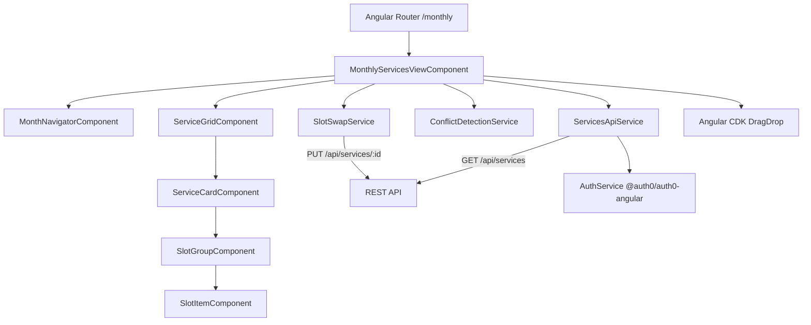

# Design Document: Monthly Services View

## Overview

The Monthly Services View is a new standalone Angular 17 component at `/monthly` that fetches worship services from the REST API for a selected month, displays them in a two-column alternating layout with songs grouped by slot category, detects and highlights song conflicts across a ±365-day window, and supports drag-and-drop swapping of song slots between services.

Each slot shows a human-readable slot label (e.g. "Opening Hymn") and the hymn text (number, name and translation, e.g. "A10 Grote God (E7)"). Because hymn names are not yet stored, the design also covers a backend change in `music-planner-api`: a new `songs.name` column, a CSV backfill migration, a seed update, and returning `name` from `GET /api/services`.

Auth0 authentication is provided by `@auth0/auth0-angular`, which must be installed and configured in the app. The component follows the same standalone pattern as the existing `schedule/` component.

---

## Architecture



### File Structure

```
src/app/monthly-services-view/
  monthly-services-view.component.ts      # Root page component
  monthly-services-view.component.html
  monthly-services-view.component.css
  monthly-services-view.component.spec.ts
  components/
    month-navigator/
      month-navigator.component.ts
      month-navigator.component.html
      month-navigator.component.css
    service-card/
      service-card.component.ts
      service-card.component.html
      service-card.component.css
    slot-item/
      slot-item.component.ts
      slot-item.component.html
      slot-item.component.css
  services/
    services-api.service.ts               # HTTP calls to GET/PUT /api/services
    conflict-detection.service.ts         # Pure conflict computation logic
    slot-swap.service.ts                  # Orchestrates drag-drop PUT calls + revert
  models/
    service.model.ts                      # TypeScript interfaces matching API shapes
    slot-labels.ts                        # Slot_Label_Table + getSlotLabel + formatHymnDisplayText (pure)
```

Backend changes (`music-planner-api`):

```
src/db/migrations/008-add-song-name.ts    # NEW: add songs.name + CSV backfill
src/db/migrations/006-load-song-repertoire.ts  # CHANGED: seed without `name`
src/seeds/seedSongsFromCsv.ts             # CHANGED: store trimmed name; export helpers; includeName option
src/models/Song.ts                        # CHANGED: declare `name`
src/repositories/ServiceRepository.ts     # CHANGED: return `name` on song and translationOf
```

---

## Components and Interfaces

### MonthlyServicesViewComponent (page root)

Owns the selected month state, triggers API fetches, holds the loaded services array, and passes data down to child components. Also owns the CDK drag-drop list connections.

**Responsibilities:**
- Initialize selected month to current month on `ngOnInit`
- Fetch services for the display month (current month only) and the conflict window (±12 months)
- Pass display services + conflict map to `ServiceCardComponent`
- Handle drag-drop events from CDK and delegate to `SlotSwapService`
- Show loading spinner and error banners

**Template structure:**
```
<app-month-navigator>
<mat-spinner *ngIf="loading">
<div class="error-banner" *ngIf="error">
<div class="service-grid">
  <div class="grid-row" *ngFor="each pair of servicePairs">
    <app-service-card [service]="pair[0]" [conflictMap]="conflictMap" cdkDropList>
    <app-service-card [service]="pair[1]" [conflictMap]="conflictMap" cdkDropList>
```

---

### MonthNavigatorComponent

Displays the current month label and previous/next buttons.

**Inputs:** `selectedMonth: moment.Moment`
**Outputs:** `monthChange: EventEmitter<moment.Moment>`

```html
<button mat-icon-button (click)="prev()">‹</button>
<span>{{ selectedMonth | date:'MMMM yyyy' }}</span>
<button mat-icon-button (click)="next()">›</button>
```

---

### ServiceCardComponent

Displays a single service card. Groups slots by category and renders them. Each slot is a CDK drag item.

**Inputs:**
- `service: ServiceViewModel` — the service to display
- `conflictMap: ConflictMap` — pre-computed conflict data keyed by slot id
- `allDropLists: CdkDropList[]` — connected drop lists for cross-service drag-drop

**Template structure:**
```
<mat-card>
  <mat-card-header>{{ service.serviceDate }} — {{ service.serviceType }}</mat-card-header>
  <div class="slot-group" *ngFor="let group of slotGroups">
    <div class="category-label">{{ group.category }}</div>
    <app-slot-item *ngFor="let slot of group.slots" [slot]="slot" [conflict]="conflictMap[slot.id]" cdkDrag>
```

---

### SlotItemComponent

Renders a single song slot with conflict colour indicator and tooltip.

**Inputs:**
- `slot: ServiceSlotViewModel`
- `conflict: SlotConflictStatus | null`

Applies CSS class based on conflict severity: `conflict-red`, `conflict-yellow`, `conflict-green`.

**Content (Requirement 6):**
- Shows `slot.slotLabel` (from the Slot_Label_Table) as the slot's label.
- Shows `slot.hymnDisplayText` for occupied slots (e.g. "A10 Grote God (E7)"), or the empty-slot placeholder when `songId` is null.
- No longer renders `slotTemplate.category` or the raw `slotKey` in the slot entry. The category group heading in `ServiceCardComponent` (`.category-label`) is unchanged.

```html
<span class="slot-label">{{ slot.slotLabel }}</span>
<span class="slot-song" *ngIf="slot.hymnDisplayText; else emptySlot">{{ slot.hymnDisplayText }}</span>
<ng-template #emptySlot><span class="slot-empty">Empty</span></ng-template>
```

---

### Slot labels and hymn display text (`models/slot-labels.ts`)

Pure, stateless helpers with no Angular dependencies, so they are directly property-testable.

```typescript
export const SLOT_LABEL_TABLE: Readonly<Record<string, string>> = {
  orchestra1: '1', orchestra2: '2', orchestra3: '3', orchestra4: '4', orchestra5: '5',
  choir1: '1', choir2: '2', choir3: '3', choir4: '4',
  congregationBS: 'Before Service',
  congregationOH: 'Opening Hymn',
  congregationRP: 'Repentance',
  congregationCM1: 'Communion 1',
  congregationCM2: 'Communion 2',
};

/** Unknown keys fall back to the raw slotKey (Req 6.5). */
export function getSlotLabel(slotKey: string): string {
  return Object.prototype.hasOwnProperty.call(SLOT_LABEL_TABLE, slotKey)
    ? SLOT_LABEL_TABLE[slotKey]
    : slotKey;
}

/** "<number> <name> (<translationOf.number>)"; name omitted when null/blank, brackets omitted without translation. */
export function formatHymnDisplayText(song: Song): string {
  const parts = [song.number];
  if (song.name && song.name.trim() !== '') parts.push(song.name);
  if (song.translationOf) parts.push(`(${song.translationOf.number})`);
  return parts.join(' ');
}
```

`hasOwnProperty` is used so keys such as `constructor` or `toString` fall back to the raw key instead of resolving to inherited object members.

---

### ServicesApiService

Handles all HTTP communication with the API.

```typescript
@Injectable({ providedIn: 'root' })
export class ServicesApiService {
  getServices(from: string, to: string): Observable<Service[]>
  updateServiceSlots(serviceId: string, slots: SlotInput[]): Observable<Service>
}
```

Uses `AuthService.getAccessTokenSilently()` from `@auth0/auth0-angular` to obtain a Bearer token, then attaches it via an `HttpInterceptor` or inline `switchMap`.

---

### ConflictDetectionService

Pure, stateless service containing the conflict computation algorithm. No HTTP calls.

```typescript
@Injectable({ providedIn: 'root' })
export class ConflictDetectionService {
  buildConflictMap(allServices: Service[]): ConflictMap
}
```

Returns a `ConflictMap` (keyed by slot id) that the page component passes to service cards.

---

### SlotSwapService

Orchestrates the two-PUT swap operation with optimistic UI update and rollback on failure.

```typescript
@Injectable({ providedIn: 'root' })
export class SlotSwapService {
  swap(
    sourceSlot: ServiceSlotViewModel,
    targetSlot: ServiceSlotViewModel,
    sourceService: ServiceViewModel,
    targetService: ServiceViewModel
  ): Observable<[Service, Service]>
}
```

---

## Data Models

### API response shapes (from `models/service.model.ts`)

```typescript
export interface Song {
  number: string;
  hymnal: string;
  name: string | null;                 // hymn title; null when not stored (Req 10.11, 10.13)
  translationOf?: { number: string; name: string | null; hymnal: string };
}

export interface SlotTemplate {
  slotKey: string;
  category: 'orchestra' | 'choir' | 'congregation';
  displayOrder: number;
}

export interface ServiceSlot {
  id: string;
  serviceId: string;
  slotTemplateId: string;
  songId: string | null;
  slotTemplate: SlotTemplate;
  song: Song | null;
}

export interface Service {
  id: string;
  congregationId: string;
  serviceDate: string;   // YYYY-MM-DD
  serviceType: string;
  serviceSlots: ServiceSlot[];
}

export interface SlotInput {
  slotKey: string;
  songId: string | null;
}
```

### View models (enriched for the template)

```typescript
export interface SlotConflictStatus {
  severity: 'red' | 'yellow' | 'green' | null;
  conflictingDates: Array<{ date: string; serviceType: string }>;
}

// ConflictMap: slot.id -> SlotConflictStatus
export type ConflictMap = Record<string, SlotConflictStatus>;

export interface ServiceSlotViewModel extends ServiceSlot {
  canonicalNumber: string;  // translationOf.number ?? song.number
  slotLabel: string;        // getSlotLabel(slotTemplate.slotKey)
  hymnDisplayText: string | null;  // formatHymnDisplayText(song); null when the slot is empty
}

export interface SlotGroup {
  category: 'orchestra' | 'choir' | 'congregation';
  slots: ServiceSlotViewModel[];
}

export interface ServiceViewModel extends Service {
  serviceSlots: ServiceSlotViewModel[];
  slotGroups: SlotGroup[];  // pre-grouped, sorted by displayOrder
}
```

### Month navigation state

```typescript
interface MonthState {
  displayMonth: moment.Moment;   // the month shown in the view
  displayFrom: string;           // first day of displayMonth (YYYY-MM-DD)
  displayTo: string;             // last day of displayMonth (YYYY-MM-DD)
  conflictFrom: string;          // displayMonth - 12 months (YYYY-MM-DD)
  conflictTo: string;            // displayMonth + 12 months (YYYY-MM-DD)
}
```

---

## Conflict Detection Algorithm

The algorithm mirrors the logic in the existing `schedule.component.ts` `calculateConflicts` method, adapted for the API data shape.

### Canonical number resolution

For each slot, the canonical song number used for matching is:
```
canonicalNumber = slot.song.translationOf?.number ?? slot.song.number
```

### Algorithm (ConflictDetectionService.buildConflictMap)

```
Input: allServices: Service[]   (covers ±12 months around the display month)

1. Build a flat list of all occupied slots across all services:
   songOccurrences = allServices
     .flatMap(svc => svc.serviceSlots
       .filter(slot => slot.songId !== null)
       .map(slot => ({
         slotId: slot.id,
         serviceId: svc.id,
         serviceDate: svc.serviceDate,
         serviceType: svc.serviceType,
         canonicalNumber: slot.song.translationOf?.number ?? slot.song.number
       }))
     )

2. For each occurrence O in songOccurrences:
   a. Find all other occurrences P where:
      - P.canonicalNumber === O.canonicalNumber
      - NOT (P.serviceId === O.serviceId AND P.slotId === O.slotId)
        (same service, same slot = skip; same service, different slot = include per Req 7.7)
   b. For each matching P, compute:
      diffDays = |daysBetween(O.serviceDate, P.serviceDate)|
   c. Classify:
      - diffDays <= 56  → red conflict
      - 57 <= diffDays <= 90  → yellow (quarter conflict)
      - 91 <= diffDays <= 365 → green (year conflict)
   d. Assign the worst severity to O's slot entry in the ConflictMap
      (red > yellow > green > null)
   e. Accumulate conflicting dates for the tooltip

3. Return ConflictMap
```

### Day difference calculation

```typescript
const diffDays = Math.abs(
  moment(a.serviceDate).diff(moment(b.serviceDate), 'days')
);
```

### Severity precedence

When a slot has conflicts at multiple severity levels, the worst (red) takes precedence for the colour indicator. All conflicting dates are accumulated for the tooltip regardless of severity.

---

## Drag and Drop Interaction Design

### CDK DragDrop setup

- Each `ServiceCardComponent` hosts a `cdkDropList` with `id="service-<serviceId>"`
- All drop lists are connected to each other via `[cdkDropListConnectedTo]` — the page component collects all `CdkDropList` references and passes them to each card
- Each `SlotItemComponent` is a `cdkDrag` item
- `cdkDropListSortingDisabled="true"` — slots are not reordered within a list, only swapped across lists

### Drop event handling

```
onDrop(event: CdkDragDrop<ServiceSlotViewModel[]>):
  if event.previousContainer === event.container → ignore (same service)
  sourceSlot = event.item.data
  targetSlot = event.container.data[event.currentIndex]
  if targetSlot is empty (songId === null) → still allow (swap null into source)
  
  optimistically swap songIds in the view model
  disable all drag interactions (swapping = true)
  
  slotSwapService.swap(sourceSlot, targetSlot, sourceService, targetService)
    .subscribe({
      next: ([updatedSource, updatedTarget]) => {
        update both service view models from API response
        recompute conflict map
        swapping = false
      },
      error: () => {
        revert optimistic swap
        show error snackbar
        swapping = false
      }
    })
```

### Visual feedback during drag

- Dragged item gets a `cdk-drag-preview` style with slight elevation
- Drop targets highlight on hover via `cdkDropListEnterPredicate` (reject same-service drops)
- While `swapping = true`, all `cdkDrag` items have `[cdkDragDisabled]="swapping"` applied

### PUT payload construction

For each affected service after a swap, the full updated slots array is sent:
```typescript
const slots: SlotInput[] = service.serviceSlots.map(s => ({
  slotKey: s.slotTemplate.slotKey,
  songId: s.songId
}));
```

---

## Auth0 Integration

`@auth0/auth0-angular` must be installed:
```bash
npm install @auth0/auth0-angular
```

Configure in `app.config.ts`:
```typescript
import { provideAuth0 } from '@auth0/auth0-angular';

export const appConfig: ApplicationConfig = {
  providers: [
    provideRouter(routes),
    provideAnimationsAsync(),
    provideHttpClient(withInterceptorsFromDi()),
    provideAuth0({
      domain: environment.auth0Domain,
      clientId: environment.auth0ClientId,
      authorizationParams: {
        redirect_uri: window.location.origin,
        audience: environment.auth0Audience,
      }
    })
  ]
};
```

Token attachment in `ServicesApiService`:
```typescript
constructor(private auth: AuthService, private http: HttpClient) {}

private withToken<T>(req: (token: string) => Observable<T>): Observable<T> {
  return this.auth.getAccessTokenSilently().pipe(
    switchMap(token => req(token))
  );
}

getServices(from: string, to: string): Observable<Service[]> {
  return this.withToken(token =>
    this.http.get<Service[]>(`/api/services`, {
      params: { from, to },
      headers: { Authorization: `Bearer ${token}` }
    })
  );
}
```

---

## Backend: Hymn Name Persistence (`music-planner-api`)

Existing migrations are `001`–`007` in `src/db/migrations`, so the new migration is **`008-add-song-name.ts`**. Migrations are discovered by umzug glob and run in filename order. Production uses Postgres and the Jest tests use SQLite (`sqlite3`), so the raw SQL must be portable between the two.

### Migration ordering risk and resolution

Migration `006-load-song-repertoire.ts` calls `seedSongsFromCsv()`, which goes through the `Song` model. Once `Song` declares `name`:

- `Song.upsert({...})` builds an `INSERT` that can include `name`, and `Song.findOne({ where })` (pass 2) selects every model attribute including `name`.
- On a fresh database, 006 runs before 008, so the `songs.name` column does not exist yet and both statements fail with "column name does not exist".

Resolution: 006 must never touch `name`. Migration 008 is the only place that creates the column and populates it for existing data.

| Change | Detail |
|---|---|
| `seedSongsFromCsv(options?: { includeName?: boolean })` | `includeName` defaults to `true` (Req 10.7, for standalone seed runs after migrations). When `false`, the upsert omits `name` and passes `fields: ['number', 'hymnal', 'signature', 'tempo', 'familiarity', 'translationOfId']` so the generated SQL never references `name`. |
| Pass 2 lookups | `Song.findOne({ where, attributes: ['id', 'number'] })` for source and target, so the `SELECT` never references `name`. |
| `006-load-song-repertoire.ts` `up` | Calls `seedSongsFromCsv({ includeName: false })`. |
| `006` `down` | `Song.update({ translationOfId: null }, { where: {} })` only sets `translation_of_id` and `updated_at`, and `Song.destroy` does not select columns, so `down` needs no change. Rollback runs 008 `down` first (dropping `name`), so this holds. |
| `007-import-brentwood-schedule.ts` | Already uses `Song.findAll({ attributes: ['id', 'number'] })`, so it is unaffected and needs no change. |

After the whole sequence, 008 backfills `name` from the CSV for every row 006 loaded. The result is the same as running the updated seed on an already migrated database.

### Migration 008: add `songs.name` and backfill

```typescript
import { QueryInterface, DataTypes, QueryTypes } from 'sequelize';
import { resolveCsvPath, parseCsv } from '../../seeds/seedSongsFromCsv';

export async function up({ context: qi }: { context: QueryInterface }): Promise<void> {
  const table = await qi.describeTable('songs');
  if (!table['name']) {
    await qi.addColumn('songs', 'name', { type: DataTypes.STRING(255), allowNull: true });
  }

  const rows = parseCsv(resolveCsvPath());
  const existing = await qi.sequelize.query<{ number: string }>(
    'SELECT number FROM songs', { type: QueryTypes.SELECT });
  const known = new Set(existing.map(r => r.number.toUpperCase()));

  for (const row of rows) {
    if (!row.number) continue;
    const key = row.number.toUpperCase();
    if (!known.has(key)) {
      console.warn(`Name backfill: no song for CSV number ${key}`);   // Req 10.3
      continue;
    }
    if (!row.name) continue;
    await qi.sequelize.query(
      'UPDATE songs SET name = :name WHERE UPPER(number) = :number AND name IS NULL',
      { replacements: { name: row.name.slice(0, 255), number: key } });
  }
}

export async function down({ context: qi }: { context: QueryInterface }): Promise<void> {
  await qi.removeColumn('songs', 'name');
}
```

Design decisions:

- **Raw `queryInterface` and SQL, not the `Song` model.** The migration then depends only on the schema at that point in history, not on the current model definition.
- **`resolveCsvPath` and `parseCsv` are exported from `seedSongsFromCsv.ts`** and reused, so the CSV location logic (`assets/repertoir.csv`, then `.data/repertoir.csv`) and pipe-delimited parsing (`Hymnal|Number|Name|TranslationNumber_HymnalE`, trimmed fields) exist once. Importing the module only loads the `Song` model definition and does not query the database.
- **Case-insensitive match** by upper-casing the CSV number against `UPPER(number)`.
- **Idempotence (Req 10.4).** The `name IS NULL` guard means a second run changes no row that already has a name. `describeTable` guards `addColumn` so a re-run after a partial failure does not error.
- **Unmatched CSV rows** are detected against a pre-read set of song numbers (not an affected-row count, which differs between SQLite and Postgres), logged with `console.warn`, and skipped.
- **`down`** removes the column (Req 10.5).
- **Testability.** The loop body is factored into an exported `backfillSongNames(qi, rows)` that `up` calls with `parseCsv(resolveCsvPath())`, so tests can inject generated rows.

### Song model and seed

- `Song.ts`: add `declare name: string | null;` and `name: { type: DataTypes.STRING(255), allowNull: true }`.
- `seedSongsFromCsv.ts`: when `includeName` is true, `Song.upsert` includes `name: row.name.trim() || null` (Req 10.7). `parseCsv` already trims each field.

### Repository

In `ServiceRepository.ts` `SERVICE_INCLUDE`:

```typescript
attributes: ['number', 'hymnal', 'name', 'familiarity'],     // song
// translationOf:
attributes: ['number', 'hymnal', 'name'],
```

Sequelize returns `null` for a NULL column, which satisfies Req 10.11 without extra mapping. The route layer serialises the model with its existing JSON output.

---

## Correctness Properties

*A property is a characteristic or behavior that should hold true across all valid executions of a system — essentially, a formal statement about what the system should do. Properties serve as the bridge between human-readable specifications and machine-verifiable correctness guarantees.*

### Property 1: Month navigation is a round trip

*For any* valid month M, navigating to the next month and then back to the previous month SHALL return to M — the selected month after next→previous SHALL equal the original month M.

**Validates: Requirements 2.2, 2.3**

---

### Property 2: API date range matches selected month

*For any* selected month M, the `from` parameter passed to `GET /api/services` SHALL equal the first day of M in `YYYY-MM-DD` format, and the `to` parameter SHALL equal the last day of M in `YYYY-MM-DD` format.

**Validates: Requirements 2.4**

---

### Property 3: Conflict window spans ±12 months

*For any* selected month M, the conflict-window API call SHALL use `from` equal to the first day of M minus 12 months and `to` equal to the last day of M plus 12 months, both in `YYYY-MM-DD` format.

**Validates: Requirements 7.1**

---

### Property 4: Bearer token is attached to every API request

*For any* access token string T returned by Auth0, every HTTP request made by `ServicesApiService` SHALL include an `Authorization` header with the value `Bearer T`.

**Validates: Requirements 3.6, 9.1**

---

### Property 5: Non-200 responses produce no rendered services

*For any* HTTP error status code (4xx or 5xx) returned by the API, the component SHALL display zero service cards and SHALL display a non-empty error message string.

**Validates: Requirements 3.4**

---

### Property 6: Services are assigned to columns in alternating order

*For any* array of N services sorted by `serviceDate` ascending, the service at index i SHALL be assigned to column `(i % 2) + 1` — odd indices to column 1, even indices to column 2.

**Validates: Requirements 4.2, 4.4**

---

### Property 7: Slots within a service card are ordered by displayOrder

*For any* service with a set of service slots, the slots rendered within each category group SHALL appear in ascending `slotTemplate.displayOrder` order.

**Validates: Requirements 5.3**

---

### Property 8: Conflict classification is correct for all day-difference ranges

*For any* two occupied slots sharing the same canonical song number in services with dates D1 and D2, the conflict severity assigned SHALL be:
- `red` when `|D1 − D2| ≤ 56` days
- `yellow` when `57 ≤ |D1 − D2| ≤ 90` days
- `green` when `91 ≤ |D1 − D2| ≤ 365` days
- `null` when `|D1 − D2| > 365` days

**Validates: Requirements 7.3, 7.4, 7.5**

---

### Property 9: Canonical number uses translationOf when present

*For any* song slot where `song.translationOf` is defined, the canonical number used for conflict matching SHALL equal `song.translationOf.number`, not `song.number` — two slots with different `song.number` values but the same `translationOf.number` SHALL be detected as conflicting.

**Validates: Requirements 7.6**

---

### Property 10: Drag-drop swap exchanges songIds

*For any* two slots A (in service S1) and B (in service S2, S2 ≠ S1), after a successful drag-drop swap operation, slot A SHALL have B's original `songId` and slot B SHALL have A's original `songId`.

**Validates: Requirements 8.2**

---

### Property 11: Same-service drops are rejected

*For any* two slots that belong to the same service, the CDK drop predicate SHALL return `false`, preventing the drop from completing.

**Validates: Requirements 8.6**

---

### Property 12: Hymn display text formatting

*For any* song with a number N, an optional name (null, empty, or non-empty) and an optional translation number T, `formatHymnDisplayText` SHALL return N, followed by a space and the name only when the name is non-blank, followed by a space and `(T)` only when a translation exists. In particular, the result always starts with N, contains the name when non-blank, and contains brackets if and only if a translation exists (e.g. `A10 Grote God (E7)`, `A10 (E7)`, `A10 Grote God`, `A10`).

**Validates: Requirements 6.1, 6.2, 6.6**

---

### Property 13: Slot label mapping with fallback

*For any* `slotKey`, `getSlotLabel` SHALL return the Slot_Label_Table value when the key is one of the 14 listed keys, and SHALL return the raw `slotKey` unchanged otherwise (including keys such as `constructor` or the empty string).

**Validates: Requirements 6.3, 6.5**

---

### Property 14: Hymn name round trip through the API

*For any* repertoire of songs (with arbitrary casing of numbers, names that are blank or padded with whitespace, and optional translation links) and any CSV that may include rows with no matching song, loading songs without `name`, running the backfill, and reading each song through `ServiceRepository` SHALL return `song.name` and `song.translationOf.name` equal to the trimmed CSV `Name` for that number, or `null` when the CSV name is blank or the song has no CSV row. Seeding through `seedSongsFromCsv` with names enabled SHALL produce the same stored names.

**Validates: Requirements 10.2, 10.3, 10.7, 10.9, 10.10, 10.11, 10.12**

---

### Property 15: Name backfill is idempotent

*For any* set of songs and CSV rows, running the backfill a second time SHALL leave every `songs.name` value unchanged compared with the state after the first run.

**Validates: Requirements 10.4**

---

## Error Handling

| Scenario | Component behaviour |
|---|---|
| User not authenticated | Show "Please log in" prompt; do not call API |
| Auth0 `getAccessTokenSilently` fails | Show authentication error; offer login button |
| API returns 401 | Show "Not authenticated" message |
| API returns 403 | Show "Access denied" message |
| API returns 4xx (other) | Show descriptive error; clear service list |
| API returns 5xx | Show "Server error, please try again" message |
| Network timeout / offline | Show "Could not reach server" message |
| PUT swap fails (one or both) | Revert optimistic UI swap; show error snackbar |
| PUT swap in flight | Disable all drag interactions; show spinner on affected cards |
| Song `name` is `null` or blank | Show the song number (and translation brackets) without a name |
| Unknown `slotKey` | Show the raw `slotKey` as the slot label |
| CSV row has no matching song during backfill (008) | Log a warning with the unmatched number and continue |
| CSV file not found during 008 | Migration fails with the list of searched paths (same behaviour as `seedSongsFromCsv`) |

All error messages are displayed in a dismissible `mat-snack-bar` or inline banner. Partial data is never rendered — on any error the service list is cleared.

---

## Testing Strategy

### Dual Testing Approach

- **Unit tests** (Karma + Jasmine): specific examples, edge cases, error conditions, component rendering
- **Property-based tests** (fast-check): universal properties across generated inputs

### Unit / Example Tests

Key example tests:

- Component initialises with current month selected
- Navigating to `/monthly` renders the `MonthlyServicesViewComponent`
- Loading spinner shown while API call is in flight
- Empty state message shown when API returns `[]`
- 401 response shows authentication error message
- Drag-drop disabled while swap is in progress
- Both PUT calls are made with correct payloads after a swap
- Optimistic swap is reverted when one PUT fails
- Slot item renders the slot label and hymn display text, and does not render the category label or raw slotKey; the category heading remains in the service card (Req 6.3, 6.4)
- Migration 008: `up` adds a nullable `name` column, `down` removes it (SQLite test DB)
- Full migration sequence 001–008 succeeds on a fresh DB with a small CSV, with `Song` declaring `name` (Req 10.8)
- `ServiceRepository` returns `name: null` for a song with no stored name
- `seedSongsFromCsv` stores the trimmed name

### Property-Based Tests (fast-check)

Library: `fast-check` — install as a dev dependency:
```bash
npm install --save-dev fast-check
```

Each property test runs a minimum of **100 iterations**.

Tag format: `// Feature: monthly-services-view, Property <N>: <property_text>`

| Property | Generator | Assertion |
|---|---|---|
| P1: Month navigation round trip | `fc.integer({ min: 0, max: 11 })` for month, `fc.integer({ min: 2000, max: 2099 })` for year | `next().prev()` returns original month |
| P2: API date range matches month | `fc.date(...)` mapped to month start | `from` = first day, `to` = last day |
| P3: Conflict window spans ±12 months | `fc.date(...)` mapped to month | `conflictFrom` = month−12mo, `conflictTo` = month+12mo |
| P4: Bearer token attached | `fc.string({ minLength: 10 })` as token | `Authorization` header = `Bearer <token>` |
| P5: Non-200 → no services rendered | `fc.integer({ min: 400, max: 599 })` as status | zero cards rendered, error message non-empty |
| P6: Alternating column assignment | `fc.array(serviceArbitrary, { minLength: 1, maxLength: 20 })` | service at index i in column `(i%2)+1` |
| P7: Slots ordered by displayOrder | `fc.array(slotArbitrary)` with shuffled displayOrder | rendered order matches sorted displayOrder |
| P8: Conflict classification | `fc.integer({ min: 0, max: 400 })` as day diff + two slot arbitraries | severity matches threshold rules |
| P9: Canonical number uses translationOf | `fc.record` with optional `translationOf` | conflict detected when translationOf.number matches |
| P10: Swap exchanges songIds | two slot arbitraries with different serviceIds | after swap, songIds are exchanged |
| P11: Same-service drop rejected | slot arbitrary with same serviceId | drop predicate returns false |
| P12: Hymn display text formatting | `fc.record` with `number`, `name` as `fc.option(fc.string())` (include `''` and whitespace), optional `translationOf.number` | output equals the expected composition of number, name (if non-blank) and `(T)` (if translated) |
| P13: Slot label mapping with fallback | `fc.oneof(fc.constantFrom(...14 known keys), fc.string())` | known keys map to the table value; all other keys return themselves |
| P14: Name round trip through the API | `fc.array` of unique song numbers with random casing, CSV names (blank, padded, non-blank), optional translation links, extra unmatched CSV rows | `ServiceRepository` returns trimmed CSV name or `null` on song and `translationOf` |
| P15: Backfill idempotence | same generators as P14 | snapshot of `songs.name` after run 2 equals snapshot after run 1 |

P12 and P13 run in Karma with `fast-check` (frontend). P14 and P15 run in Jest with `fast-check` (already a dev dependency of `music-planner-api`) against the SQLite test DB from `src/tests/testDb.ts`. They call the migration's backfill logic and `ServiceRepository`, with the CSV supplied from a temporary file or injected rows, and each iteration resets the `songs` table.

### Property Test Configuration

```typescript
import fc from 'fast-check';

fc.assert(fc.property(...), { numRuns: 100 });

const serviceArbitrary = fc.record({
  id: fc.uuid(),
  serviceDate: fc.date({ min: new Date('2020-01-01'), max: new Date('2030-12-31') })
    .map(d => d.toISOString().slice(0, 10)),
  serviceType: fc.constantFrom('Sunday Service', 'Midweek Service'),
  serviceSlots: fc.array(slotArbitrary, { maxLength: 14 })
});

const slotArbitrary = fc.record({
  id: fc.uuid(),
  songId: fc.option(fc.uuid(), { nil: null }),
  slotTemplate: fc.record({
    slotKey: fc.string({ minLength: 1 }),
    category: fc.constantFrom('orchestra', 'choir', 'congregation'),
    displayOrder: fc.integer({ min: 1, max: 100 })
  }),
  song: fc.option(fc.record({
    number: fc.string({ minLength: 1 }),
    hymnal: fc.string({ minLength: 1 }),
    name: fc.option(fc.string(), { nil: null }),
    translationOf: fc.option(fc.record({
      number: fc.string({ minLength: 1 }),
      name: fc.option(fc.string(), { nil: null }),
      hymnal: fc.string({ minLength: 1 })
    }), { nil: undefined })
  }), { nil: null })
});
```
