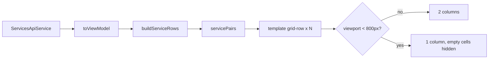

# Design Document: Sunday Services Right Column

## Overview

`MonthlyServicesViewComponent` builds `servicePairs` with `chunkPairs`, which groups consecutive services two at a time. This design replaces that call with a pure function, `buildServiceRows`, that places Sunday services (by `serviceDate` weekday) in the right cell and non-Sunday services in the left cell, while keeping the list in chronological order. The template keeps its two-cell row structure. A CSS media query collapses the grid to one column below 800px.

Design decisions:

- **Pure function in its own util file.** `services/service-rows.util.ts` follows the existing `service-form.util.ts` pattern and makes the logic testable without TestBed.
- **Weekday from `serviceDate`.** `moment(serviceDate, 'YYYY-MM-DD').day() === 0`. `serviceType` is free text and is ignored.
- **Row shape unchanged.** The result stays `(ServiceViewModel | null)[][]` (`[left, right]`), so `servicePairs` and the template keep working. Only the builder changes.
- **Stacked order for free.** Each row is `[left, right]` and rows are chronological, so DOM order is already chronological. The narrow layout only needs a one-column grid and hidden empty cells.

## Architecture



The builder runs in the two places `chunkPairs` runs today: after a successful load, and after a successful slot swap.

## Components and Interfaces

### `services/service-rows.util.ts` (new)

```ts
import moment from 'moment';

export type ServiceRow<T> = [T | null, T | null]; // [left, right]

export function isSundayService(svc: { serviceDate: string }): boolean {
  return moment(svc.serviceDate, 'YYYY-MM-DD').day() === 0;
}

export function buildServiceRows<T extends { serviceDate: string }>(
  services: T[]
): ServiceRow<T>[] {
  const rows: ServiceRow<T>[] = [];
  let pending: T | null = null; // latest non-Sunday not yet placed
  for (const svc of services) {
    if (isSundayService(svc)) {
      rows.push([pending, svc]);
      pending = null;
    } else {
      if (pending) rows.push([pending, null]);
      pending = svc;
    }
  }
  if (pending) rows.push([pending, null]);
  return rows;
}
```

The function assumes the input is already sorted by date, as the API returns it today. It does not sort.

### `MonthlyServicesViewComponent`

- Remove the private `chunkPairs`.
- Replace both `this.chunkPairs(this.displayServices)` calls with `buildServiceRows(this.displayServices)`.
- Keep the field name `servicePairs`, typed `(ServiceViewModel | null)[][]`.

### Template

No structural change. The existing `grid-cell-empty` placeholder already renders for a null cell. Add a `class="grid-cell-empty"` hook only if it is missing; it is present for both cells today.

### CSS

```css
@media (max-width: 799px) {
  .grid-row { grid-template-columns: 1fr; }
  .grid-cell-empty { display: none; }
}
```

## Data Models

No model changes. `Service.serviceDate` (`YYYY-MM-DD`) is the only input field. A row is `[left, right]`, where each element is a `ServiceViewModel` or `null`.

## Correctness Properties

*A property is a characteristic or behavior that should hold true across all valid executions of a system-essentially, a formal statement about what the system should do. Properties serve as the bridge between human-readable specifications and machine-verifiable correctness guarantees.*

### Property 1: Placement by weekday

For any list of services with arbitrary dates and arbitrary `serviceType` values, every non-null service in a row's right cell has a Sunday `serviceDate`, and every non-null service in a row's left cell has a non-Sunday `serviceDate`.

**Validates: Requirements 1.1, 1.2, 2.1, 2.2**

### Property 2: Order and completeness

For any chronologically sorted list of services, reading the non-null cells of the result row by row, left then right, yields exactly the input list, with each service appearing once.

**Validates: Requirements 2.3, 4.1**

### Property 3: Pairing with the preceding service

For any chronologically sorted list of services, each row whose right cell holds a Sunday service has a left cell equal to the immediately preceding input element if that element is a non-Sunday service, and null otherwise. Each row whose right cell is null holds a non-Sunday service on the left.

**Validates: Requirements 3.1, 3.2, 3.3, 3.4**

## Error Handling

- Invalid or unparseable `serviceDate`: Moment returns an invalid date and `day()` returns `NaN`, so the service is treated as non-Sunday and goes left. No exception is thrown.
- Load failure: the existing error handler sets `servicePairs = []`, which renders no rows (Requirement 5.4).

## Testing Strategy

Property-based testing applies to `buildServiceRows` because it is a pure function with a large input space. UI wiring and CSS use example-based and smoke checks.

**Property tests** (fast-check ^4.7.0, already a dev dependency, in `services/service-rows.util.spec.ts`):

- Minimum 100 runs per property, one test per property.
- Generator: arrays of `{ id, serviceDate, serviceType }`, with dates drawn from a range of days, sorted ascending, and `serviceType` drawn from `'Sunday Service'`, `'Morning'`, and arbitrary strings.
- Tag format: `Feature: sunday-services-right-column, Property N: <text>`.

**Unit tests:**

- `buildServiceRows([])` returns `[]` (Requirement 4.2).
- Example month: Wed, Sun, Wed, Fri, Sun, Sat produces `[Wed,Sun]`, `[Wed,null]`, `[Fri,Sun]`, `[Sat,null]`.
- A month starting with a Sunday yields `[null, Sun]` first.
- A `serviceType` of `'Sunday Service'` on a Tuesday goes left.

**Component tests** (`monthly-services-view.component.spec.ts`):

- After load, `servicePairs` matches `buildServiceRows` output and a placeholder renders for null cells (Requirements 5.1, 5.3).
- After a successful swap, `servicePairs` is rebuilt (Requirement 5.2).
- On load error, `servicePairs` is empty (Requirement 5.4).

**Smoke check (CSS):** the component stylesheet contains the `max-width: 799px` media query with a one-column grid and hidden empty cells, and the default `grid-template-columns: 1fr 1fr` (Requirements 6.1 to 6.4). Verify the stacked look manually in the browser.
